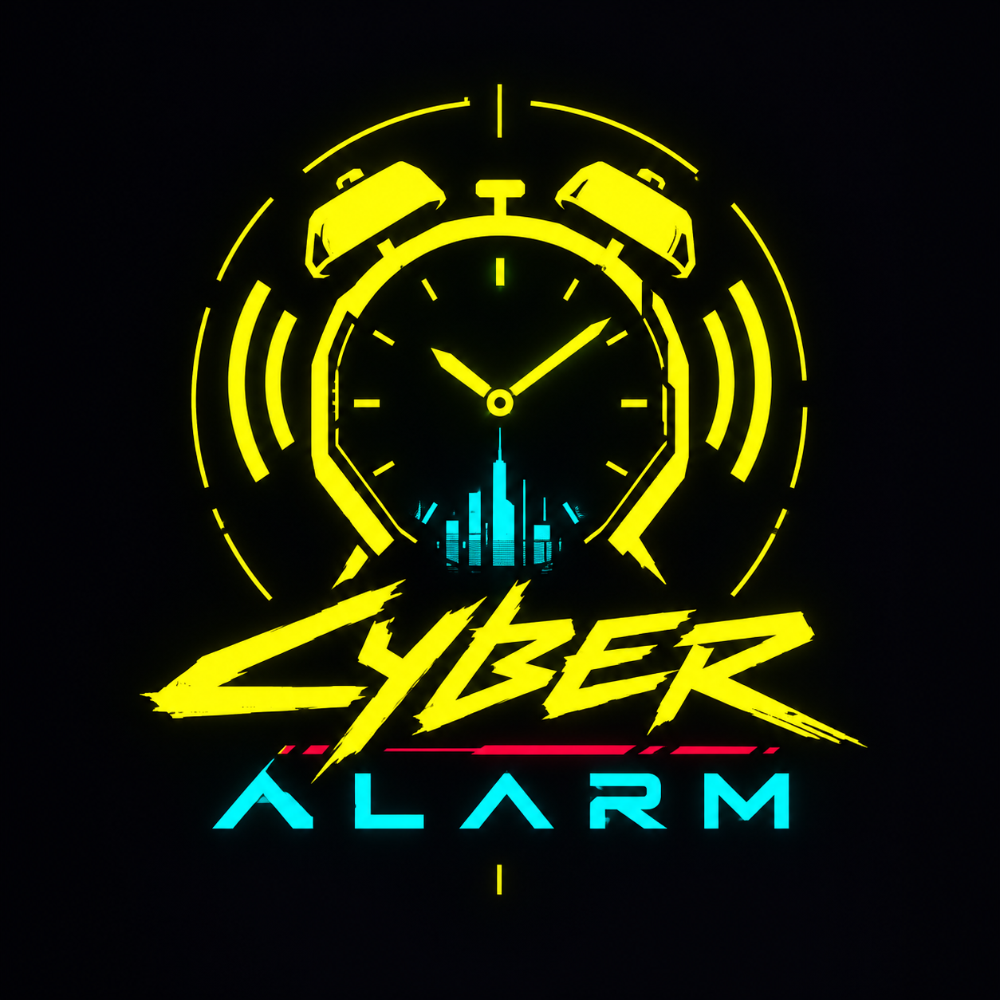

<p align="center">
  
</p>

<h3 align="center">CYBER-ALARM // the alarm clock that doesn't believe your lies, choom</h3>

---

```
> NIGHT_CITY_OS v2.4.1
> MOUNTING WAKE PROTOCOLS ......... OK
> NEURAL LINK ..................... OK
> WELCOME BACK, CHOOM
```

## Listen up

Name's not important. What's important: I grew up in Watson, and in Watson you don't get second chances. You oversleep, somebody else takes your gig, your eddies, maybe your apartment. Seen it happen to better runners than you.

Normal alarm clocks? Gonk tech. You slap 'em, you roll over, you wake up three hours later with the sun in your face and a fixer leaving you voicemails. So I put this together. **Cyber-Alarm** is an Android alarm clock that makes you *earn* getting out of bed. No snooze-slapping your way out. You want it quiet, you prove your brain's booted.

Native Android, Kotlin, Jetpack Compose. Night City chrome all over it. Runs on your phone, buzzes your wrist if you got a watch. Let's go.

## What it does

### Ringing: no way out but through

- **Rings like it means it.** Exact alarms, wakes your phone out of deep sleep, takes over the lock screen full-screen.
- **You don't dismiss it, you beat it.** Stack up a chain of challenges and it only shuts up when every link is solved:
  - **MATH_PROTOCOL**: addition only, 'cause nobody's doing long division at 6 AM. Wrong answer? Phone buzzes, question stays. No reroll.
  - **BREACH_PROTOCOL**: hack the code matrix, row, column, row, column, upload the sequence. Unlock **LEGEND** difficulty when your cred's high enough. Zero slack, every pick counts.
  - **CONNECT_4**: beat a minimax AI. On hard it doesn't make mistakes. You will.
  - **SEQUENCE_RECALL**: watch the grid, repeat the pattern.
  - **MIX_MATCH**: pair symbols, words, colors. Hard mode messes with your eyes.
  - **STEP_DRIVE**: get up and walk. Shaking it under the blanket? Yeah, I thought of that. Kinda.
  - **JACK_IN**: scan a QR code, any barcode, or an NFC tag you stuck somewhere *away from the bed*. Kitchen, bathroom, front door. And here's the part I'm proud of: hit **GO QUIET** and the alarm mutes for **5 minutes** while you walk over. No need to wake the whole megabuilding just 'cause *you* got a job. Once per ring though. Don't scan in time, it comes back screaming.
- **Can't run from it.** Hit Home, it drags you back. Open another app, a shield drops over it. Turn the phone off? It boots back up ringing. Swipe it away, kill it, it resurrects in seconds.

### After you're up

- **Awake checks.** Five minutes after you dismiss, then ten: *"STILL WITH US, CHOOM?"* Quick sum, 90 seconds on the clock. Miss it and the alarm comes back **escalated**: full volume, no snooze, harder challenges. Every miss makes the next one worse. Learned that one the hard way.
- **Wake Report.** How long you took, how many times you gonked an answer, snoozes, streak, and what it all paid out. A fixer voice says something nice if you did good. Or not, if you didn't.
- **App lock.** Pick the apps that eat your mornings. After the alarm they're locked for as long as you set. Open one and you get **ACCESS DENIED**. Solve a challenge for a 10-minute pass. The countdown sits in your status bar and in Samsung's **Now Bar** as a live timer.

### Street Cred

- Wake up clean and you earn **eddies (€$)**. Wake fast, bonus. Keep a streak going, bigger bonus. Snooze, miss checks, botch answers? It costs you.
- Climb the ladder: **STREET KID → PUNK → SOLO → MERC → LEGEND.**
- Rank unlocks stuff: crew themes (**MILITECH**, **NETWATCH**, **ARASAKA**), new alarm tones (**AFTERLIFE**, **ARASAKA_TOWER**), and **LEGEND**-level Breach.
- **Daily gig.** Every day a fixer drops a job: crack a subnet, beat a Tyger Claws AI, count somebody's eddies. Do it, get paid. One per day, no double-dipping.
- **WAKE_LOG** keeps your whole history: every wake, every relapse, every eddie.

### Everyday stuff

- **Repeat days, snooze rules, your own music** as the alarm tone.
- **Skip next.** Day off tomorrow? Skip one ring without killing the alarm.
- **Holiday mode.** Repeating alarms go quiet for 1–60 days. One-time alarms still ring, 'cause you set those on purpose.
- **Bedtime reminder.** Pings you when it's time to crash so you still get your sleep goal. **Night lock** can lock your doomscroll apps from bedtime till the alarm.
- **Home-screen widget** with a live countdown to your next alarm, plus the lock timer.
- **UI sounds.** Three packs (SYNTH, GLITCH, TERMINAL), or drop in your own clips. Every tap clicks your wrist bones with haptics.
- **Backup / restore** to a JSON file. Alarms, settings, tags, history, cred. New phone, same legend.
- **Wear OS companion.** Your watch buzzes when the alarm rings and pops up the awake check with an **OPEN ON PHONE** button. It can't dismiss anything. That's on purpose. You'd cheat. I would.

Plus Night City quotes on the main screen, lingo everywhere, and a boot splash that glitches in like a cheap optic implant on a cold morning.

## Getting it on your phone

1. Go to **[Releases](../../releases/latest)** and grab `cyber-alarm-v2.4.1.apk`. Got a Wear OS watch? Grab `cyber-alarm-wear-v2.4.1.apk` too.
2. Open the APK on your phone. Android will whine about unknown sources. Let it.
3. First launch shows the **permissions dashboard**. Grant the **CORE** ones or the alarm can't do its job. The **ENFORCER** ones are what make it hard to escape:
   - **Display over other apps**: the shield and the drag-back.
   - **Accessibility**: closes the power menu while ringing, catches locked apps. Greyed out? *App info → ⋮ → Allow restricted settings*, then try again.
   - **Usage access**: backup way to catch locked apps.
   - **Unrestricted battery**: so the OS doesn't flatline the alarm mid-ring.
4. **Samsung choom?** Also put Cyber-Alarm in *Settings → Battery → Background usage limits → Never sleeping apps*. Samsung loves killing things.
5. **Watch:** sideload the wear APK over ADB (wireless debugging on the watch, `adb pair`, `adb connect`, `adb install`). Same signing key as the phone app or they won't talk.

Needs **Android 8.0+**. Watch needs **Wear OS 3+**.

## Straight talk: what it can't do

I'm a street kid, not a liar. Stock Android has hard limits and no app gets past them:

- **The power button can't be blocked.** Long-press power-off works. Cyber-Alarm just re-fires the second the phone boots.
- **Home and Recents can't be disabled.** It can only yank you back instantly.
- **Force stop from Settings** kills it till you open it again. That's Android. If you're doing that, you're awake enough anyway.

## Night City lingo, for the corpos reading this

| Word | Means |
|---|---|
| **choom** | friend, buddy |
| **gonk** | idiot. Don't be one. |
| **preem** | premium, top-tier |
| **nova** | cool |
| **delta** | leave, get moving |
| **eddies / €$** | eurodollars, money |
| **flatline** | die. Or, here, fail. |
| **zeroed** | killed. Also your locked apps. |
| **chrome** | cyberware |
| **jack in** | plug in. Here: scan your tag. |

## Building from source

```bash
git clone https://github.com/Kareem-maherr/cyber-alarm.git
cd cyber-alarm
./gradlew :app:assembleDebug        # phone  -> app/build/outputs/apk/debug/
./gradlew :wear:assembleDebug       # watch  -> wear/build/outputs/apk/debug/
./gradlew :app:testDebugUnitTest    # the logic tests
```

JDK 17 and the Android SDK (API 36). Under the hood: Kotlin, Jetpack Compose, MVVM, Hilt, Room, AlarmManager `setAlarmClock`, a foreground service with a full-screen intent, CameraX + ML Kit for codes, NFC reader mode, and the Wear Data Layer.

## Credits

- **UI sound packs GLITCH and TERMINAL:** [Kenney.nl](https://kenney.nl) "Interface Sounds", CC0. Preem work, Kenney.
- **Fonts:** Chakra Petch and Share Tech Mono, SIL Open Font License 1.1.
- License texts ship inside the app under `assets/licenses/`.

## Disclaimer

Fan-made. Not affiliated with, endorsed by, or sponsored by CD PROJEKT RED. *Cyberpunk 2077* and its names are trademarks of CD PROJEKT S.A. No game assets are included. Every sound, picture, and line of code in here is original, free-licensed, or yours.

---

<p align="center"><i>Wake up, choom. We got a city to burn.</i></p>
